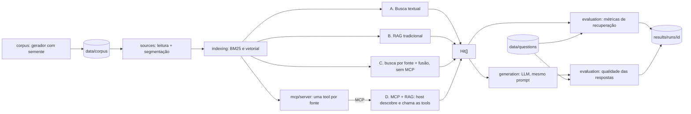

# Arquitetura — proposta inicial (para discussão)

Status: **implementado** da ingestão à avaliação das respostas (A–D, servidor MCP, `src/generation`, `src/evaluation`); estatística **planejada**. Ver `STATUS.md`.

## 1. Princípio

Todas as abordagens implementam a mesma interface e recebem as mesmas entradas.
Tudo o que vem depois da recuperação (geração, avaliação, benchmark) é **um único
código** compartilhado. Isso é o que torna a comparação controlada.

```ts
interface Retriever {
  name: string;
  search(query: string, k: number): Promise<Hit[]>; // Hit = trecho + fonte + score
}
```

## 2. Fluxo



## 3. Decisões

| # | Tema | Decisão | Registro |
| --- | --- | --- | --- |
| 1 | Linguagem e ferramentas | Node.js 22, TypeScript 5.9, Vitest, GitHub Actions | [001](decisoes/001-linguagem-e-ferramentas.md) |
| 2 | Banco vetorial | PostgreSQL 16 + pgvector (Docker), busca exata | [002](decisoes/002-banco-vetorial.md) |
| 3 | Embeddings e LLM | Ollama local: `bge-m3` para embeddings e `qwen3:4b-instruct-2507` para a geração | [003](decisoes/003-embeddings-e-llm.md) |
| 4 | MCP | SDK oficial, stdio no experimento | [004](decisoes/004-mcp.md) |
| 5 | Configurações | A (BM25), B (RAG), C (controle sem MCP), D (MCP + RAG) | [005](decisoes/005-configuracoes-comparadas.md) |
| 6 | Medida da H1 | latência computacional, recuperação e recuperação + geração separadas | [006](decisoes/006-medida-da-h1.md) |
| 7 | Avaliação das respostas | regra dos fatos (âncora), juiz `qwen3.5:4b` só nas respostas afirmativas, planilha cega para humanos | [007](decisoes/007-avaliacao-das-respostas.md) |

Metodologia e métricas: [metodologia.md](metodologia.md). Corpus: [corpus.md](corpus.md).
O LLM foi fixado em 31/10/2026, depois de um piloto com três modelos (ADR 003).

## 4. Demonstração (opcional, depois do benchmark)

Uma UI de demonstração, no estilo de um caderno de perguntas sobre as fontes (fontes à
esquerda, chat no centro, trechos citados com a fonte de origem), ajuda na banca, mas
**não faz parte do experimento** e não entra nas métricas. Para não custar retrabalho:

- `src/api/`: API HTTP fina (ex.: Fastify) com `GET /sources`, `POST /ask { question, approach }`
  que só chama o mesmo `Retriever` + `generation` usados no benchmark;
- `apps/demo/`: front simples que consome essa API, feito por último.

Assim a demo mostra exatamente o que foi medido, sem lógica própria.

## 5. Fora de escopo

Autenticação, dados reais, deploy em nuvem, upload de documentos pelo usuário.
