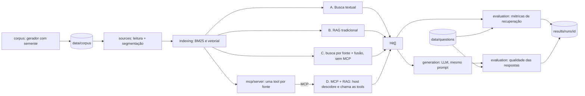

# Arquitetura — proposta inicial (para discussão)

Status: **implementado** da ingestão à avaliação das respostas (A–D, servidor MCP, `src/generation`, `src/evaluation`); estatística implementada (ADR 008). Ver `STATUS.md`.

## 1. Princípio

Todas as abordagens implementam a mesma interface e recebem as mesmas entradas.
Tudo o que vem depois da recuperação (geração, avaliação, benchmark) é **um único
código** compartilhado. Isso é o que torna a comparação controlada.

```ts
interface Retriever {
  name: string;
  search(query: string, k: number): Promise<Hit[]>; // Hit = trecho + fonte + score
}
```

## 2. Fluxo



## 3. Decisões

| # | Tema | Decisão | Registro |
| --- | --- | --- | --- |
| 1 | Linguagem e ferramentas | Node.js 22, TypeScript 5.9, Vitest, GitHub Actions | [001](decisoes/001-linguagem-e-ferramentas.md) |
| 2 | Banco vetorial | PostgreSQL 16 + pgvector (Docker), busca exata | [002](decisoes/002-banco-vetorial.md) |
| 3 | Embeddings e LLM | Ollama local: `bge-m3` para embeddings e `qwen3:4b-instruct-2507` para a geração | [003](decisoes/003-embeddings-e-llm.md) |
| 4 | MCP | SDK oficial, stdio no experimento | [004](decisoes/004-mcp.md) |
| 5 | Configurações | A (BM25), B (RAG), C (controle sem MCP), D (MCP + RAG) | [005](decisoes/005-configuracoes-comparadas.md) |
| 6 | Medida da H1 | latência computacional, recuperação e recuperação + geração separadas | [006](decisoes/006-medida-da-h1.md) |
| 7 | Avaliação das respostas | regra dos fatos (âncora), juiz `qwen3.5:4b` só nas respostas afirmativas, planilha cega para humanos | [007](decisoes/007-avaliacao-das-respostas.md) |
| 8 | Estatística | Wilcoxon pareado + Holm + IC por bootstrap; Mann-Whitney U ao lado (TCC 1) | [008](decisoes/008-estatistica.md) |

Metodologia e métricas: [metodologia.md](metodologia.md). Corpus: [corpus.md](corpus.md).
O LLM foi fixado em 31/10/2026, depois de um piloto com três modelos (ADR 003).

## 4. Demonstração (implementada em 01/11/2026)

Uma UI de demonstração, no estilo de um caderno de perguntas sobre as fontes (fontes à
esquerda, chat no centro, trecho citado à direita com a fonte de origem), ajuda na banca, mas
**não faz parte do experimento** e não entra nas métricas.

- `src/api/app.ts`: API HTTP fina em `node:http` (sem dependência nova; Fastify não trazia
  ganho para 4 rotas): `GET /api/config`, `GET /api/sources`, `GET /api/units/:id` e
  `POST /api/ask { question, approach }`. O `ask` chama o mesmo `Retriever.search(q, 5)` e o
  mesmo `generateAnswer` do `bench:generation`, então a demo mostra exatamente o que foi medido.
  A só devolve os trechos.
- `src/api/server.ts`: monta as abordagens com `src/bench/setup.ts` (D sobe o servidor MCP por
  stdio, como no benchmark) e entrega o front.
- `apps/demo/`: HTML, CSS e JS sem build; as citações `[id]` da resposta viram botões que abrem
  o trecho.

```bash
npm run demo                                                     # ambiente real (depois de npm run ingest)
npm run demo -- --embedder hash --store memory --llm simulated   # sem Docker; sem valor experimental
```

**Modo de avaliação humana cega** (`src/api/eval.ts`, `apps/demo/avaliar.*`; ADR 007):

```bash
npm run eval:human -- --run <execução de bench:generation> --out <planilha>   # gera planilha, chave e instruções
npm run demo -- --avaliacao <planilha> [--host 0.0.0.0]                       # só Node; sem Ollama nem banco
npm run eval:human -- --import <planilha> --ratings results/runs/<planilha>/avaliacoes-ui/a.csv,results/runs/<planilha>/avaliacoes-ui/b.csv
```

Com `--avaliacao`, só o modo de avaliação fica no ar (a demonstração revelaria as abordagens).
Cada avaliador entra com o nome, vê uma resposta distinta por vez (C e D, quando iguais, são
uma linha só; a nota vale para as duas), com pergunta, referência, trechos e resposta, e dá as
três notas da rubrica. As notas são salvas a cada resposta em
`results/runs/<planilha>/avaliacoes-ui/<avaliador>.csv`, no formato da planilha cega. A tela
mostra a concordância (alfa de Krippendorff ordinal) com 2 ou mais avaliadores; as médias por
abordagem só saem no `--import`, para não quebrar a cegueira.

## 5. Fora de escopo

Autenticação, dados reais, deploy em nuvem, upload de documentos pelo usuário.
