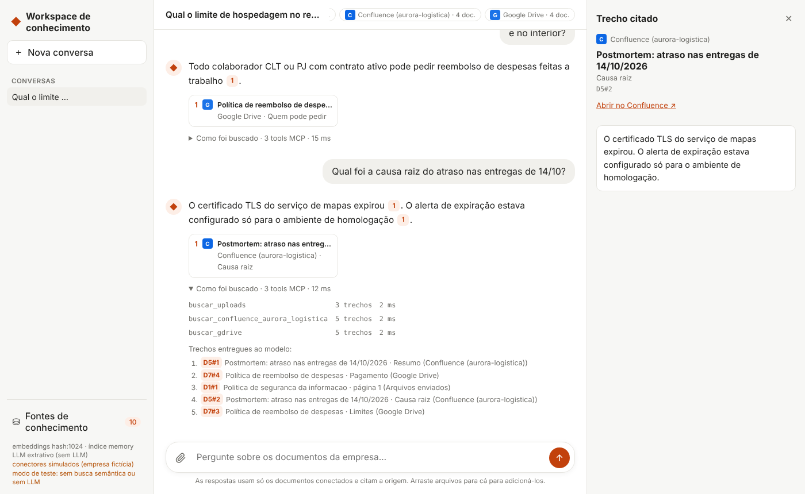
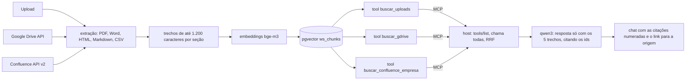

# App corporativo (workspace de conhecimento)

Status: **implementado e testado com APIs simuladas** (01/11/2026). Ainda **não testado** com
uma conta real do Google nem da Atlassian, nem aberto com `bge-m3` + `qwen3` (o ambiente de
desenvolvimento não alcança o Ollama nem as APIs reais). Fora do experimento: nada daqui entra
nas métricas (ADR 012).

Um chat no estilo dos assistentes comerciais sobre o conhecimento da empresa. A empresa coloca
o conteúdo de três jeitos:

| Fonte | Como entra | O que é lido |
| --- | --- | --- |
| Upload | arrastar arquivos para o chat ou para "Fontes de conhecimento" | `.pdf`, `.docx`, `.md`, `.txt`, `.html`, `.csv`, `.json`, até 15 MB por arquivo |
| Google Drive | botão "Conectar Google Drive" (OAuth do Google, só leitura) | Google Docs, PDF, Word, texto e Markdown; a conta inteira ou uma pasta |
| Confluence (Atlassian) | URL do site + e-mail + API token | páginas atuais de todos os espaços ou dos espaços escolhidos |



## Como o contexto funciona



1. **Indexação.** Cada documento vira seções (títulos do Markdown, `h1`–`h4` do HTML exportado
   pelo Google Docs e do Confluence, estilos de título do Word, páginas do PDF) e as seções
   viram trechos de até 1.200 caracteres. Cada trecho é indexado com o título do documento e o
   da seção, como no experimento. O id do trecho é curto (`D12#3`) para o LLM conseguir citar.
2. **Sincronização incremental.** Cada documento guarda a versão da origem (data de modificação
   no Drive, número da versão no Confluence, SHA-256 no upload). "Sincronizar agora" lista a
   origem, reindexa só o que mudou e tira do índice o que foi apagado, movido ou perdeu
   permissão. Um documento com erro não derruba a fonte: a versão anterior continua no índice e
   o erro aparece no cartão da fonte. Falhas transitórias (429, 5xx, rede, tempo esgotado) são
   repetidas 3 vezes com espera exponencial; 401 e 403 não.
3. **Uma tool MCP por fonte.** O servidor MCP do workspace expõe `buscar_<fonte>` para cada
   fonte conectada, com a descrição editável no cartão da fonte. A cada pergunta, o host lista
   as tools, chama todas com a pergunta e junta os trechos por RRF (a mesma função das
   configurações C e D). Conectar uma fonte nova cria uma tool nova sem mudar o host.
4. **Resposta.** O LLM recebe os 5 melhores trechos, as 4 últimas mensagens da conversa e a
   regra de usar só os trechos e citar os ids; sem informação, responde a frase de abstenção.
   Pergunta de continuação curta ("e no interior?") é buscada junto com a pergunta anterior.
   Na UI, as citações viram números, cada número abre o trecho e o link da origem, e "Como foi
   buscado" mostra as tools chamadas, os trechos e os tempos.

## Como rodar

```bash
npm install
docker compose up -d
docker compose exec ollama ollama pull bge-m3
docker compose exec ollama ollama pull qwen3:4b-instruct-2507-q4_K_M
npm run workspace              # http://127.0.0.1:3001 (pgvector + bge-m3 + qwen3)
```

Opções: `--port`, `--host`, `--dados <pasta>` (padrão `workspace-data/`, fora do git),
`--store pg|memory`, `--embedder ollama|hash`, `--llm ollama|extrativo`, `--model`,
`--conectores reais|simulados`.

Para conhecer a interface sem conta Google nem Atlassian:

```bash
npm run workspace -- --conectores simulados              # com Ollama e pgvector
npm run workspace -- --conectores simulados --embedder hash --store memory --llm extrativo  # sem Docker
```

Com `--conectores simulados` o Drive e o Confluence são APIs falsas com os documentos de uma
empresa fictícia (Aurora Logística, `src/workspace/connectors/mock.ts`); no Confluence use
`demo@aurora.com.br` e `token-demo` (já preenchidos). Os dados ficam em
`workspace-data/simulado/`. `--embedder hash` não é semântico e `--llm extrativo` não gera
texto (copia a frase mais parecida de cada trecho): servem só para ver a interface. As imagens
deste documento foram feitas nesse modo.

## Conectar o Google Drive de verdade

1. No [Google Cloud Console](https://console.cloud.google.com/), crie (ou escolha) um projeto e
   ative a **Google Drive API** (APIs e serviços > Biblioteca).
2. Em **Tela de consentimento OAuth**: tipo **Interno** se a conta for do Google Workspace da
   empresa (sem verificação do Google); senão **Externo** em modo de teste, adicionando os
   e-mails que vão conectar como usuários de teste. Escopo:
   `https://www.googleapis.com/auth/drive.readonly`.
3. Em **Credenciais > Criar credenciais > ID do cliente OAuth**, tipo **Aplicativo da Web**, com
   o URI de redirecionamento autorizado `http://127.0.0.1:3001/api/connectors/google/callback`
   (ou o endereço público, se `WORKSPACE_PUBLIC_URL` estiver definido).
4. Rode com as credenciais no ambiente (ou no `.env`, que não vai para o git):

   ```bash
   GOOGLE_CLIENT_ID=... GOOGLE_CLIENT_SECRET=... npm run workspace
   ```

5. Na UI: **Fontes de conhecimento > Conectar Google Drive** (opcionalmente com o id de uma
   pasta, o trecho da URL depois de `/folders/`). O Google pede o consentimento e volta para o
   app, que começa a sincronizar.

O app guarda o refresh token em `workspace-data/credentials.json` (permissão 600) e renova o
token de acesso sozinho. Para revogar: "Desconectar" no app e
[myaccount.google.com/permissions](https://myaccount.google.com/permissions).

## Conectar o Confluence de verdade

1. Crie um API token em
   [id.atlassian.com/manage-profile/security/api-tokens](https://id.atlassian.com/manage-profile/security/api-tokens)
   com a conta que tem acesso aos espaços.
2. Na UI: **Fontes de conhecimento > Confluence**, com a URL do site
   (`https://empresa.atlassian.net`), o e-mail da conta, o token e, se quiser, as chaves dos
   espaços (`ENG, OPS`). O app confere as credenciais antes de criar a fonte.

Só o **Confluence Cloud** (API REST v2). Confluence Data Center/Server (token pessoal e API v1)
não está implementado.

## Usar o mesmo conhecimento no Claude Desktop (ou outro cliente MCP)

```json
{
  "mcpServers": {
    "workspace-conhecimento": {
      "command": "npx",
      "args": ["tsx", "/caminho/do/repositorio/src/workspace/stdio.ts"],
      "env": { "WORKSPACE_DIR": "/caminho/do/repositorio/workspace-data", "WORKSPACE_STORE": "pg" }
    }
  }
}
```

O servidor lê a mesma pasta e o mesmo índice do app; fontes conectadas no app aparecem como
tools em até 5 s (`tools/list_changed`).

## Testes

- `test/unit/workspace.test.ts` (CI, sem serviços): extração dos formatos (inclusive `.docx`
  com estilos em português e um PDF gerado no teste), segmentação, novas tentativas do cliente
  HTTP, OAuth e renovação do token do Google, paginação e filtro de espaços do Confluence,
  sincronização incremental (sem mudança não baixa nada; mudança reindexa com o mesmo id; o que
  sumiu sai; falha de um documento isolada), persistência e permissão dos segredos, troca de
  modelo de embeddings, tools MCP acompanhando as fontes, fusão no host, chat com citação e
  abstenção, e a API HTTP (upload, Confluence com credencial errada, `state` do OAuth, rotas).
- `test/integration/workspace-pg.test.ts` (precisa do pgvector): mesmo ranking do pgvector e da
  busca exata em memória, remoção por documento e por fonte. **Ainda não executado** (o
  ambiente de desenvolvimento não tem a extensão pgvector).
- Conferido no navegador (Chromium) com conectores simulados, `hash` e `extrativo`: upload de
  PDF e `.docx`, conexão do Drive e do Confluence, chat, citação, celular. Imagens em
  `docs/img/workspace/`.

## Limitações (o que falta para uma empresa usar)

- **Sem login nem multiusuário**: qualquer pessoa que alcance a porta vê tudo. Rodar em
  127.0.0.1, ou atrás de um proxy com SSO. As permissões do Drive e do Confluence **não** são
  respeitadas por usuário: tudo o que a conta conectada lê fica disponível para quem usa o app.
- **Sincronização manual** ("Sincronizar agora" ou ao conectar); não há agendamento nem webhooks.
- **Segredos em arquivo local** (permissão 600), sem cofre nem criptografia em repouso.
- PDF escaneado (imagem) não tem texto: precisa de OCR, que não está implementado.
- Google Sheets, Slides, Jira, SharePoint e Notion não estão implementados; a interface
  `Connector` (`list` com versão + `fetch` sob demanda) é o ponto de extensão.
- A busca usa só a pergunta (e a anterior, em continuações curtas); não há reescrita da
  pergunta por LLM.
- Qualidade das respostas não medida: o desempenho do `bge-m3` + `qwen3` foi medido só no
  corpus sintético do experimento.
